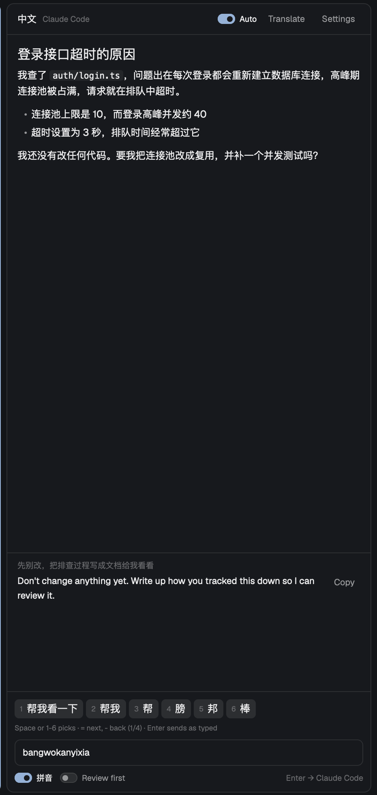

# herdr-translate

A [Herdr](https://herdr.dev) side panel for working with coding agents in English when Chinese is your stronger language.

- **Read**: the focused agent's latest reply, translated into Simplified Chinese.
- **Write**: type Chinese, pinyin or rough English, press Enter, and natural English lands in the agent's prompt. It is not sent; you read it, edit it and press Enter yourself.
- **Pinyin built in**: the box has its own pinyin input method, so it works with only an English keyboard installed.

一个 Herdr 侧边面板：把 AI 的最新回复翻译成中文给你读；你用中文、拼音或不通顺的英文输入，按 Enter 后变成地道的英文填进 AI 的输入框（不会自动发送）。面板自带拼音输入法，系统里不装中文输入法也能用。



## Requirements

- Herdr (the desktop app) with herdr-core (`hc`).
- One translation engine:
  - [Claude Code](https://claude.com/claude-code) installed and signed in (the default), or
  - Codex CLI installed and signed in, or
  - an API key for an OpenAI-compatible endpoint or the Anthropic API (macOS only; the key is kept in the Keychain).

## Install

Ask an agent running in Herdr:

> Add the mod at https://github.com/abupeiyong/herdr-translate

Or by hand:

```sh
git clone https://github.com/abupeiyong/herdr-translate.git
cp -R herdr-translate/mods/translate ~/.config/herdr-app/mods/
herdr-app check ~/.config/herdr-app/mods/translate
```

Herdr docks the panel on the right the first time it sees the folder. To place it elsewhere, set `"place": "none"` in `mod.json` and add a block `{ "content": { "mod": "translate" } }` to your own layout.

## Use

### Reading

Click the agent's pane, then **Translate**. With **Auto** on (the default), each reply is translated when the agent finishes its turn. Code, commands, file paths and numbers are left as written.

### Writing

Type in the box at the bottom and press Enter. The English is pasted into the focused terminal's prompt and the keyboard moves there. Your original and the English stay listed above the box, with a **Copy** button, so you can compare them.

Anything goes in the box:

| You type | You get |
|---|---|
| `这个改动先别提交，帮我把单测补上` | Don't commit this change yet. Please add the unit tests. |
| `bang wo kan yixia weishenme login jiekou zong chaoshi` | Could you help me take a look at why the login endpoint is always timing out? |
| `i want you check why the build is fail, dont change code first` | Check why the build is failing. Don't change any code yet. |

### Pinyin input

With **拼音** on, pinyin typed in the box shows Chinese candidates above it.

| Key | Does |
|---|---|
| Space | takes the first candidate |
| `1`–`6` | takes that candidate |
| `=` or `]` | next page |
| `-` or `[` | previous page |
| `ctrl-.` | turns pinyin on or off |
| Enter | translates whatever is in the box |

You can type a whole phrase at once (`bangwokanyixia` → 帮我看一下). Most English words are not valid pinyin and are left alone; for the ones that are (`can`, `long`), turn 拼音 off.

## Settings

**Settings** in the panel's header:

| Engine | Uses | Notes |
|---|---|---|
| Claude Code | the local `claude`, model `haiku` | fastest; about 2.5 s a sentence |
| Codex | the local `codex exec` | about 7 s a sentence |
| API | a base URL, model and key you enter | OpenAI-compatible, or `https://api.anthropic.com` |

**Save and test** makes one real translation, so a wrong model name or key shows up there. Settings are stored in `~/.config/herdr-app/translate.json`.

## Good to know

- **Your clipboard is replaced** by the English each time you press Enter. Herdr can only paste-and-submit directly, so the panel copies the text and pastes it to leave it unsent.
- **Privacy**: the terminal text being translated and what you type are sent to the engine you chose, and nowhere else.
- **Long replies**: only the last 14,000 characters of terminal text are read, so the start of a very long reply can be cut off.
- **Homophones**: the pinyin input has no sentence model, so it can pick a wrong character that sounds the same (超市 for 超时). The translation step is told to read these by context.
- **Not yet tested by hand**: candidate picking and filling the prompt were checked by rendering and by running the pinyin engine on its own, not by typing in a live window. If a stray space or digit stays in the box, please open an issue.

## How it is built

[RECIPE.md](RECIPE.md) describes the panel in enough detail for an agent to rebuild it from scratch: layout, behaviour, the commands it runs and what to watch out for.

## License

Apache-2.0. The pinyin dictionary (`mods/translate/dict.js`) is built from MIT-licensed data: word frequencies from [jieba](https://github.com/fxsjy/jieba), readings from [pinyin-data](https://github.com/mozillazg/pinyin-data) and [phrase-pinyin-data](https://github.com/mozillazg/phrase-pinyin-data). Their notices are in [NOTICE](NOTICE).
