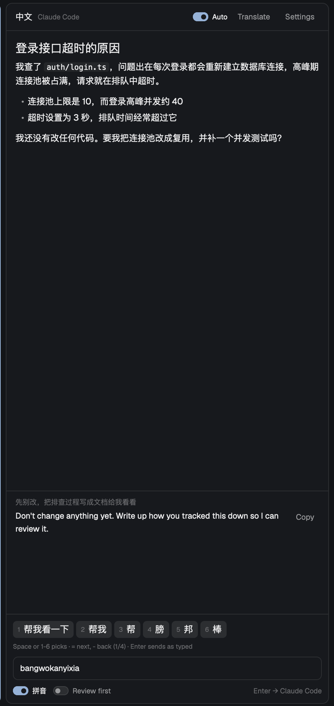

# Translate

A side panel for people who read Chinese more easily than English but want to work with coding agents in English. The top shows the focused agent's latest reply translated into Simplified Chinese. The bottom is a box where you type Chinese, pinyin or rough English; Enter rewrites it as natural English and puts it in the agent's prompt, unsent, for you to read and send. The box has its own pinyin input method, so it works with only an English keyboard installed.

## What you see

A panel 368 px wide docked on the right, drawn as a card: theme `background`, 1 px `border`, 10 px corners, 13 px text.

Top to bottom:

1. **Header**, 42 px, bottom border. "中文" in semibold, then the focused pane's program name in 11 px `dim`. On the right: an "Auto" switch, a "Translate" button and a "Settings" button (24 px high, `muted` text, `hover` background on hover).
2. **Reply**, fills the remaining height and scrolls. The Chinese translation rendered as Markdown at 13.5 px, selectable. Before any translation: a one-line hint in 12 px `dim`. Errors in 12 px `ansi1`.
3. **Sent**, only after something was sent: at most 190 px, top border, the last 3 messages for this terminal, oldest first. Each is the original text in 11 px `dim` above the English that was sent in 12.5 px, with a "Copy" button.
4. **Footer**, top border, 10 px padding:
   - a candidate bar, only while pinyin is being composed: up to 6 chips (26 px high, number in 10 px `dim`, word in 14 px; the first chip on `selected`, the others on `raised`) and a 10 px `dim` line of key hints;
   - the input box, 36 px, 8 px corners, border `accent` while focused;
   - a row with a "拼音" switch and, right-aligned in 11 px `dim`, what Enter will do ("Enter → English in Claude Code's prompt, not sent", "Translating…").

Switches are 24×14 px pills with an 8 px knob, `accent` when on.

**Settings** replaces everything under the header: three engine chips (Claude Code, Codex, API), the fields of the chosen engine, an error line, and "Save and test" / "Cancel".

## How it behaves

**Reading.** The panel follows the focused pane. "Translate" reads that terminal's screen plus 400 lines of history, keeps the last 14,000 characters and asks the model to find the agent's final message and translate it. Code, commands, paths, identifiers and numbers stay as written. With "Auto" on, the same happens when the focused pane's status leaves `working` (the agent became `idle`, `done` or `blocked`). An unchanged screen is not translated twice. Each terminal keeps its own last translation; switching panes shows that pane's.

**Writing.** Enter in the box sends the text to the model with instructions to rewrite it as clear, concise English without answering it. The English is then pasted into the focused terminal's prompt and **not submitted**: the keyboard moves to that pane, so you read it, edit it and press Enter yourself. The box clears and the pair is added to Sent. If translation fails, the reason shows in `ansi1` above the box and your text stays in the box.

**Pinyin.** With "拼音" on, the lowercase run at the end of the box is treated as pinyin and candidates appear above the box. Space takes the first candidate; `1`–`6` take that one; a click takes one too. `=` or `]` shows the next six, `-` or `[` the previous six. A candidate that covers only the first syllables leaves the rest composing. A run that cannot be cut into pinyin syllables (most English words) shows nothing and Space stays a space. `ctrl-.` in the box, or the switch, turns pinyin off for typing English words that are also pinyin ("can", "long"). Enter always translates what is in the box, unconverted pinyin included; the model reads pinyin too.

**Settings.** Engines:
- *Claude Code*: runs the local `claude` in print mode, model `haiku` by default.
- *Codex*: runs the local `codex exec`, with Codex's default model unless one is named.
- *API*: an OpenAI-compatible base URL (`…/chat/completions`) or `https://api.anthropic.com` (`/v1/messages`), a model name and a key.

"Save and test" writes the settings, makes one real translation and reports its error if it fails.

Escape in any field gives the keyboard back to the panel.

## Built from

- `mods/translate/mod.json`: `{ "place": "right", "size": 368 }`. To put it in a stack beside other panels instead, set `"place": "none"` and add a block `{ "content": { "mod": "translate" } }` to your layout.
- `main.js`: the panel. One `View`; `props().demo === true` fills it with sample content for a screenshot and does nothing else.
- `ime.js`: the pinyin engine, no UI. `candidates(run)` returns `[{ text, used }]`. It cuts the run into syllables (longest first, up to 6 cuts, an unfinished last syllable allowed), looks up whole-run words, other cuts ("xian" is also "xi'an"), a fewest-words guess for phrases (single characters cost more than words), shorter prefixes, then single characters.
- `dict.js`: 404 syllables, 7,847 characters and the 90,000 most frequent words of 2–6 characters, built from MIT-licensed data: word frequencies from [jieba](https://github.com/fxsjy/jieba), character readings from [pinyin-data](https://github.com/mozillazg/pinyin-data), phrase readings from [phrase-pinyin-data](https://github.com/mozillazg/phrase-pinyin-data). A character's first reading carries its full frequency, later readings 3% of it; words without a listed reading (about 25,000) use each character's first reading. One string, one line per pinyin key, parsed into a `Map` on first use (about 30 ms).
- `translate.svg`: an icon for a tab-bar button, if your layout has one.
- Commands: `pane.focus {pane}` then `terminal.paste`, after `cx.write_to_clipboard(english)`.
- From `herdr`: `focused()`, `panes()`, `props()`, `run`, `exec`, `hc`, `readTextFile`, `writeTextFile`, `theme()`, `appHome()`, `home()`, `checking()`.
- From `gpui-base`: `InputState` + `Input`, `TextView.markdown`, `v_flex`, `h_flex`.
- Programs it runs:
  - `hc read <terminal> --lines 400`;
  - `claude -p <text> --model <m> --system-prompt <s> --tools "" --strict-mcp-config --disable-slash-commands --no-session-persistence </dev/null`, through `sh`;
  - `codex exec --skip-git-repo-check --ephemeral -s read-only [-m <m>] -o <tmpfile> <text>`, through `sh`;
  - `security find-generic-password` / `add-generic-password` (service `herdr-translate`, account = the API URL), only for the API engine.
- Network: only the API engine, to the URL you enter. Terminal text and what you type are sent to whichever engine you chose.
- Files: reads and writes `~/.config/herdr-app/translate.json` (`engine`, `claudeModel`, `codexModel`, `apiUrl`, `apiModel`, `auto`, `ime`).

## Watch out

- **The box is a single-line `Input`.** Its `submit` fires on Enter. `Textarea` was not used because whether its Enter submits or adds a line was not verified.
- **The pinyin keys are read from the text, not from key events.** The field inserts the Space, digit or `=` first; the `change` handler sees "old text + one character", drops that character and applies the pick. The replacement runs in `cx.spawn`, after the field's own event, guarded by a flag so its `change` is ignored. This was checked by rendering and by running `ime.js` under Node, **not by typing in a live window**: treat a stray space or digit left in the box as the first thing to test.
- **`ctrl-.` is handled in the root's `on_key_down`** and was not confirmed to arrive while the field has focus. The switch always works.
- **No language model in the input method.** Phrases are covered with the fewest dictionary words, with no sense of context, so homophones come out wrong ("dengluchaoshi" gives 登陆潮湿). The writing prompt tells the model to read such characters by context.
- **`claude` waits 3 seconds for piped input** unless stdin is closed; hence `</dev/null` through `sh`. Without `--tools "" --strict-mcp-config` it loads every MCP server and takes far longer.
- **`init`'s first argument is not the block's props**; read `props()` from `herdr`.
- **Write `mod.json` before `main.js`.** A folder first seen without it is docked on the right by default.
- **Filling the prompt goes through the clipboard.** herdr-core's `send` always presses Enter, so the English is copied and pasted with `terminal.paste`. Whatever was on the clipboard is replaced by the English. This path was not run in a live window.
- **Long replies**: only the last 14,000 characters of terminal text are read, so the start of a very long reply can be cut off.
- macOS only for the API engine (it stores the key with `security`). The Claude Code and Codex engines need those programs installed and signed in.
- Measured on one machine: Claude Code with Haiku about 2.5 s for a sentence and 4 s for a screen; Codex about 7 s. The API engine was not run.

## Done when

- `herdr-app check mods/translate` passes.
- With an agent's pane focused, "Translate" shows its last reply in Chinese with code and paths unchanged.
- With "Auto" on, a reply is translated when the agent's turn ends, without a click.
- Typing `请帮我看一下为什么构建失败` and Enter puts an English sentence into the agent's prompt without submitting it, moves the keyboard there, and the pair appears under Sent.
- Typing `nihao` shows 你好 as the first candidate; Space replaces `nihao` with 你好 and leaves no space behind.
- Typing `check` shows no candidates.
- Switching the engine to Codex and pressing "Save and test" returns to the panel without an error.
